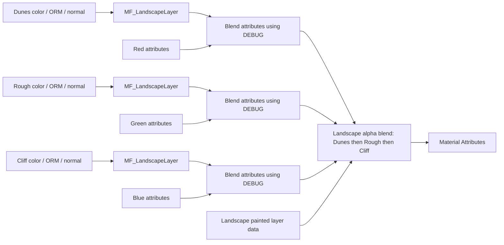

# Complete live material audit

Observed 2026-10-22, research only. No source asset or material edits/saves.
Primary evidence is exported live UObject text, not inferred package strings:
[master](audit-master.t3d), [function](audit-function.t3d),
[debug instance](audit-debug-instance.t3d), [Dunes LayerInfo](audit-dunes-layerinfo.t3d),
[texture settings](audit-texture-settings.json), and
[weight point queries](audit-mask-point-queries.json).
ObjectExporterT3D serialized these read-only snapshots into this research folder.

## Graph structure

The master has 23 expressions; its single referenced function has 12. All master
expressions belong to the traversed connected graph. There is no hidden second
surface/noise function in these expression collections. The function is reused
three times with hardwired texture objects. Current master is opaque, surface,
Default Lit, single sided, tangent-space normals, material attributes enabled.
Source: complete snapshots plus live MaterialEditingLibrary expression counts
and material property queries.



DEBUG=0 selects sampled surface attributes; DEBUG=1 selects RGB debug attributes.
The instance overrides DEBUG to 1 and has no texture/vector overrides. Sources:
master lines 116-185 and 212-237; debug instance lines 14-17.

## Surface inputs, pin masks and coordinates

Texture paths are `/Game/Textures/T_8M_Snow_{Dunes,Rough,Cliff}` with suffixes
`_BaseColor`, `_OcclusionRoughnessMetallic`, `_Normal`. All nine actual objects
are connected; these are hardwired TextureObject expressions, not exposed
texture parameters. Source: master lines 50-159.

Within MF_LandscapeLayer all three samples share `UV0 * (1 / 8)`.
UV coordinate default index/tiling (0 and 1,1) were queried live; the graph
contains a multiply, divide and constant 8. Sources: function lines 55-65,
118-130 and the previous live inspection record.

| Sample | Destination | Connected output |
| --- | --- | --- |
| Base color | Base Color | RGB |
| ORM | Ambient Occlusion | R |
| ORM | Roughness | G |
| ORM | Metallic | B |
| Normal | Normal | RGB |

Source: function lines 69-73 explicitly serialize every output mask. This
resolves the earlier uncertainty in unreal-live-investigation.md. Mesh UV0
and native Landscape UV0 have different authoring routes; the asset/geometry
report establishes the current FBX UV range and scale. World projection remains
an agreed AGP requirement, not an existing node in this master/function.

## Debug alpha: separate concepts

The owner clarified that pure RGB and alpha zero are intentional debugging
values. The graph does store A=0 in each debug Constant3Vector. Its connected
output is RGB-only into BaseColor; it does not connect that stored A to Opacity
or OpacityMask. Both are unconnected in the debug MakeMaterialAttributes nodes.
Source: master lines 161-210. Unreal source confirms Constant3Vector compiles
RGB and the default Opacity attribute is 1; see the semantics report.

The diagnostic render_weightmaps PNG is a third representation: independent
requested layer weights occupy RGB, and the unused fourth channel is black.
That API reads Landscape paint data, not the debug color graph. Its alpha zero
therefore does not demonstrate that shader opacity was baked from the instance.
The opaque preview changes visibility only and preserves every RGB byte.

## Landscape layers and order

The serialized blend list is Dunes, Rough, Cliff, each LB_AlphaBlend; no height
input is connected. Source: master lines 182-185. All three live LayerInfo
`blend_method` properties are NONE, not final-weight normalization. The legacy
`no_weight_blend` property name was unavailable; absence was not treated as a
false value. See semantics report for the UE5.7 migration/defaults.

For ordinary numeric attributes, current source compilation is equivalent to
`lerp(lerp(lerp(0,D,d),R,r),C,c)` for the present layer order. The effective
contributions are `d*(1-r)*(1-c)`, `r*(1-c)`, and `c`; remaining uncovered
contribution is `(1-d)*(1-r)*(1-c)`. This explains why raw RGB masks can be white
while the debug material resolves to blue. It does not establish normalized
normal blending. The semantics source audit establishes ordinary arithmetic on
decoded tangent normals followed by normalization in the material path. The
owner subsequently chose Dunes to fill uncovered coverage, preserving overlay
order while deliberately replacing this graph's black uncovered contribution.
Source: UE source analysis in unreal-semantics-research.md and owner answers.

## Converted mesh UVs measured directly

[Live mesh UV evidence](audit-live-mesh-uv.json) samples the first vertex
instance of each of the 4096 imported vertices at LOD0 (6272 triangles):

```text
UV0 = ((2800-localY)/100, 1-(localX+2800)/100)
UV1 = ((2800-localY)/5700, 1-(localX+2800)/5700)
```

Maximum residual against these formulas is approximately 1.1e-14 for UV0 and
4.2e-8 for UV1. This closes the earlier Unreal-side uncertainty, not the opaque
AGP FBX importer's conversion. It does not inspect every vertex corner or LOD.
Both UV0 axes still span 56 units, so dividing by 8 repeats seven times across
56 metres. Their orientation differs from the native grid. The stored import
pipeline also contains Yaw=-90; see [import snapshot](audit-import-pipeline-assets.t3d)
and the separate UV-cause investigation. Correct export/import asset preparation
is the owner's preference; do not introduce a shader compensation for this asset.

## Actual texture settings

All nine textures wrap in U/V, have zero LOD bias, no maximum size override and
virtual texture streaming disabled. Base colors are sRGB/TC_DEFAULT; normals
are linear/TC_NORMALMAP with flip_green_channel=False. Unexpectedly, all three
ORM source assets are sRGB/TC_DEFAULT, while their runtime DDS copies are linear.
Source: audit-texture-settings.json and assets/geometry report headers.

The function's ORM sample says LinearColor, but the source TextureObject can
supply effective sampler metadata; do not diagnose a compilation failure solely
from those two fields. The semantics report traces effective sampling. No
recompile was run. No dirty Landscape/Snow content packages were reported by
the live dirty-package query during this pass.

## Mask registration checks using existing bake

The previously approved 512x512 RGBA8 bake spans Unreal world XY -2800..2800,
identity transform, requested RGB order Dunes/Rough/Cliff. Source analysis says
pixel centres map to `-2800 + (pixel + 0.5) * 5600 / 512`, independently per axis.
Read-only Landscape queries at seven matching centres agree with the saved PNG
to nearest-byte rounding (max error below one byte):

| Pixel XY | PNG RGB | Source weight times 255, approximately |
| --- | --- | --- |
| 64,64 | 255,0,0 | 255,0,0 |
| 128,128 | 255,0,9 | 255,0,9.38 |
| 256,256 | 255,253,255 | 254.99,253.04,255 |
| 384,384 | 0,0,255 | 0,0,255 |
| 448,448 | 0,0,24 | 0,0,23.97 |
| 128,384 | 7,255,14 | 6.83,255,13.64 |
| 384,128 | 0,0,255 | 0,0,255 |

Source: audit-mask-point-queries.json compared read-only against the original
PNG with System.Drawing. Off-diagonal samples distinguish this registration
from a simple transpose. This supports current bake orientation and linear
numeric preservation at checked points, not arbitrary transformed landscapes,
edge sampling, DDS conversion or final runtime alignment.

## Asset identity and remaining scope

Read-only component snapshots also expose the internal allocation that Python
property reflection omitted: [corner component](audit-landscape-component.t3d)
and [centre component](audit-landscape-centre-component.t3d). Each component has
7x7 quads, one subsection. Centre component 36, section base (28,28), stores
final Cliff/Rough/Dunes in channels 0/1/2 of Weightmap_69. Corner component 0
has only Dunes in final channel 0 of Weightmap_11; its edit-layer data separately
stores Dunes in channel 2 of Weightmap_18. Packing therefore cannot be inferred
from debug RGB or copied globally from a single internal texture. The requested
render_weightmaps output order explicitly repacks named layers into the chosen
RGB contract. These are representative component observations, not a census of
every internal texture allocation.

Loading `/Game/LandscapeMaterial/MM_Landscape` resolves to
`/Game/Materials/MM_Landscape`; likewise the old MI path resolves to
`/Game/Materials/MI_Landscape`. These are redirects, not independent active
masters. The debug instance is the distinct LevelPrototyping asset above.
Source: live load_asset resolution and asset/geometry offline findings.

Remaining work is synthesis and owner decisions, not discovering additional
unvisited branches in this graph. Further behavioral experiments, such as
rendering a production material reference or a DDS round-trip, need permission.
